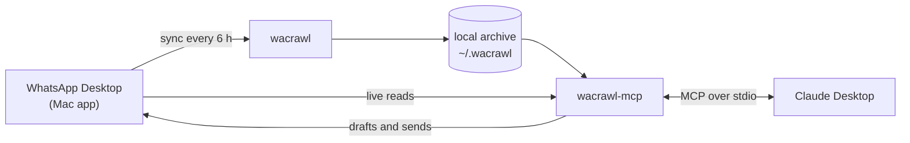

# wacrawl-mcp

**Plug your WhatsApp into any AI assistant — locally, on your Mac.** It's an
[MCP](https://modelcontextprotocol.io) server, so it isn't tied to one app: any assistant that supports
local MCP servers can search every chat, read threads, look at the photos and documents people sent you,
understand voice notes (transcribed locally), and write messages — as drafts you send yourself or, if
you turn it on, sent directly, with a check that they went out. The installer sets it up for Claude
Desktop, and the examples below use Claude.

Everything runs on your computer. Your chats aren't uploaded anywhere (see [Privacy](#privacy)).

> Unofficial project. Not affiliated with WhatsApp, Meta or Anthropic.

## What you can ask

- *"What did Sam say about the proposal last week?"*
- *"Search all my chats for where we talked about the March invoice."*
- *"What are my last 5 chats? Did Ana reply?"*
- *"Show me the PDF Laura sent yesterday"* or *"read the Word doc they just sent me"* — it actually reads
  them, even if they arrived a minute ago.
- *"Save the photo of the contract from the group to my Downloads."*
- *"What did Martín say in yesterday's voice note?"* — with [local transcription](#voice-notes-optional).
- *"Draft a follow-up to Pedro about what we discussed"* — WhatsApp opens with the message typed; you send it.
- *"Write personalized messages for these 6 people"* — they open one at a time, as you send each one.
- *"Send Ana: running 10 minutes late"* — with [direct sending](#direct-sending-optional-off-by-default)
  turned on, Claude sends it and checks that it went out.

## Ask for the outcome, not the search

The point isn't a WhatsApp search box inside a chat. It's that you stop explaining: the assistant reads
the conversations itself, so you skip the who, the where and the copy-pasting, and just ask for the
result. It gets better combined with whatever else the assistant is connected to — calendar, email,
meeting notes, your files:

- *"Do what Sofía asked me for this morning, and send her the reply when I say so."* — it finds the
  request, does the work with its other tools, and has the answer ready to go.
- *"Do what the lawyer asked for in today's meeting."* — the meeting notes say *what*; the WhatsApp
  thread with the lawyer brings the background nobody wrote down.
- *"Who came to my last three birthdays? Make a list of the friends I should invite, 30 at most, and
  invite them."* — it works out the list from those chats and queues a personal invitation for each one
  (the safeguards won't let it send everyone the same text, and they cap how many go out per hour).
- *"What did people ask me this week that I still haven't answered?"*
- *"I have a call with Marcos in ten minutes. What's pending between us?"*
- *"Put the visit the landlord confirmed on my calendar, with the address he sent."*

None of these says which chat to open or which dates to look at: that's the part you no longer do.

## How it works



- [wacrawl](https://github.com/openclaw/wacrawl) reads WhatsApp Desktop's local database and keeps a
  searchable SQLite archive, refreshed by a background sync every 6 hours.
- This server gives Claude tools over that archive, plus live reads of WhatsApp Desktop for whatever
  arrived in the last few hours.
- Writing goes through the official app: a `whatsapp://` link opens the chat with the text typed in.
  Direct sending (opt-in) presses Enter for you and checks WhatsApp's database to confirm the message
  went out.

One file (`server.js`), no npm dependencies, no network.

## Tools

| Tool | What it does |
|---|---|
| `search_messages` | Full-text search across every chat, including transcribed voice notes |
| `deep_search` | Substring search, for when full-text finds too little |
| `list_chats` | Chats by recent activity or by volume, with unread counts |
| `read_chat` | A thread in chronological order |
| `recent_messages` | What arrived seconds ago, read live from WhatsApp |
| `view_attachments` | Look at images and PDFs, read Word documents |
| `export_attachments` | Copy an attachment to a folder, to use it |
| `transcribe_audio` | Transcribe voice notes on demand, locally |
| `draft_message` | Open WhatsApp with a message typed, unsent |
| `draft_queue` | Several drafts, opened one at a time as you send them |
| `send_message` | Send for real and verify it went out (opt-in, off by default) |

## Requirements

| | |
|---|---|
| **Mac** with macOS 13 or newer | it doesn't run on Windows or Linux ([alternative](#windows-or-linux)) |
| **WhatsApp Desktop** (the Mac app, not WhatsApp Web), linked to your phone | [whatsapp.com/download](https://www.whatsapp.com/download) or the App Store |
| **Claude Desktop** | [claude.ai/download](https://claude.ai/download) |

That's all: you don't need Node.js, git or the developer tools. If you have Node.js 18 or newer, the
installer uses a copy of it; if not, it downloads one that only this server uses.

Voice note transcription also needs an Apple Silicon Mac (M1 or later).

Claude doesn't need skills, plugins or any extra setup: the server tells Claude how to use each tool
and how to read the results.

## Install

Open **Terminal** (⌘Space, type *Terminal*), paste this and press Enter:

```bash
curl -fsSL https://raw.githubusercontent.com/renzactus/wacrawl-mcp/master/install.sh | bash
```

That's the whole install. It downloads the project to `~/wacrawl-mcp`, checks the requirements, installs
`wacrawl` (verifying its checksum), builds your local archive, sets up an automatic sync every 6 hours and
registers the server with Claude Desktop. The first import takes a few minutes.

If macOS asks whether **Terminal** can access data from other apps, allow it: that's how it reads WhatsApp.

At the end it walks you through the two things macOS won't let a script do:

1. **Full Disk Access.** It opens the right screen and copies a path to your clipboard: click **+**,
   press **⌘⇧G**, paste, **Open**, and turn it on.

   > That permission is only for a copy of node used **exclusively** by this server — not for your
   > system's node — so no other program inherits it. Almost everything works without it; you just can't
   > see what arrived seconds ago or use the draft queue.

2. **Quit Claude Desktop with ⌘Q**, if it's open (closing the window isn't enough). The installer is
   waiting for that: it registers the server and opens Claude again. Done.

   > **Why it has to be quit:** Claude Desktop reads its configuration when it starts and **rewrites it
   > when it quits**. If you edit it while the app is open, quitting erases what you added. If you stop
   > the installer before Claude closes, or ran it from inside Claude, quit Claude and run
   > `~/wacrawl-mcp/register.sh` in Terminal.

<details>
<summary>Rather read the code first, or install it somewhere else?</summary>

The command runs [`install.sh`](install.sh). To read it before running anything, clone the repo and run
the same installer from there:

```bash
git clone https://github.com/renzactus/wacrawl-mcp.git ~/wacrawl-mcp
~/wacrawl-mcp/install.sh
```

To install into another folder, put `WACRAWL_MCP_DIR` before `bash`:
`curl -fsSL https://raw.githubusercontent.com/renzactus/wacrawl-mcp/master/install.sh | WACRAWL_MCP_DIR=~/somewhere bash`.
The rest of this README assumes `~/wacrawl-mcp`.

</details>

The server speaks plain MCP over stdio, so other MCP clients can run it too; the scripts set up Claude
Desktop.

## Check that it works

Ask Claude: *"what are my last 3 WhatsApp chats?"*

If something's off, run the diagnostic — it shows how each message type renders, whether times are
right, how far behind the archive is, and whether the automatic sync is working:

```bash
~/wacrawl-mcp/check.sh
```

(It uses `python3`; if macOS offers to install the developer tools, accept.)

## Privacy

**What stays on your Mac:** all of your WhatsApp. The archive (`~/.wacrawl/`), the images and
documents, and the server itself. None of it is uploaded anywhere.

**What leaves your Mac:** only what Claude *reads* to answer you. If you ask about a chat, the messages
it looks at go into that Claude conversation, just as if you had pasted them, and they stay in your
Claude history like any other chat.

**Shared Claude accounts:** access to your WhatsApp belongs to **your Mac**, not to the account.
Someone signing in to the same account from another computer can **not** query your WhatsApp. But they
**can** see your Claude conversations, including any WhatsApp messages Claude read in them. If several
people share an account, each should assume the others see what they looked up. One account per person
is the way to go (a Team plan, for example).

**Nothing is sent unless you turn it on.** By default Claude can only leave a message typed in
WhatsApp, and you're the one who presses Enter. [Direct sending](#direct-sending-optional-off-by-default)
is off.

## Sending messages

Three levels, from the most to the least hands-on:

| | What Claude does | Who presses Enter |
|---|---|---|
| **Draft** | opens the chat with the message typed | you |
| **Queue** | several drafts: opens the next one when it sees you sent the current one | you |
| **Direct send** (opt-in) | types it, presses Enter and checks WhatsApp's database to confirm it went out | Claude |

### Drafts

- **One:** *"draft a message to Ana saying…"*
- **Several:** *"write messages for these people and queue them up"*. The first one opens; **when it
  detects you sent it, it opens the next one** (~3 s). If you take your time with one, it waits. If you
  don't send one within 10 minutes, the queue pauses. You can say *skip*, *resume* or *cancel*.

### Direct sending (optional, off by default)

Claude can **send** the message, not just leave it typed: it opens the chat in WhatsApp Desktop, presses
Enter, and **checks WhatsApp's database to confirm it went out**. It goes through the official app — no
unofficial client involved.

It's **off on purpose**: sending messages in your name is your call. To turn it on:

```bash
~/wacrawl-mcp/enable-sending.sh
```

The script turns it on and opens the **Accessibility** settings with the path already copied: click
**+**, **⌘⇧G**, paste, **Open**, and turn it on (that's what lets it press Enter). Then quit (⌘Q) and
reopen Claude Desktop. The first time, macOS may ask whether it can control "System Events": allow it.

To turn it off: `~/wacrawl-mcp/enable-sending.sh --off` (it takes effect without restarting).

Recommended: **let Claude Desktop ask for your permission every time** it uses `send_message` (don't
pick "always allow"). It's the last safeguard, and the model can't skip it.

### Safeguards

They live in code, not in the prompt (a runaway model ignores instructions, not an `if`), and their
counters are saved on disk so restarting doesn't reset them:

- at most 3 drafts per minute and 15 per hour, and at most 10 sends per hour
- **never the same text to several people** (the broadcast pattern WhatsApp punishes)
- one-to-one chats only: WhatsApp doesn't open groups this way
- a warning when it's a number you've never talked to
- a send only presses Enter if WhatsApp is the frontmost app (otherwise the Enter would land in another
  app), and if it can't confirm the message went out it **doesn't retry**, so nothing goes out twice
- **emergency stop:** `touch ~/.wacrawl/STOP` stops every draft and send; delete the file to turn them back on

You can adjust them in `~/.wacrawl/limits.json`, for example `{"perHour": 40, "antiBroadcast": false}`.
Keys: `perMinute`, `perHour`, `sendsPerHour`, `maxLength`, `antiBroadcast`, `queueMax`, `queueWaitMin`,
`allowSending`.

> **Careful with cold messages.** Going through the official app avoids the risks of an unofficial
> client, but WhatsApp's terms forbid bulk and automated messaging, and WhatsApp can restrict a number
> that many strangers block or report. Keep the volume low and the messages genuinely personal. Your
> account, your responsibility.

## Voice notes (optional)

Transcribes your voice notes **on your Mac, without sending them anywhere**, with Whisper (the same kind
of model paid services use). Claude then reads them as text and **finds them in searches**: *"which
voice note mentioned the price?"* works.

```bash
~/wacrawl-mcp/setup-whisper.sh
```

- Needs a Mac with an **Apple chip** (M1 or later). It downloads the model once (~1.6 GB).
- It asks for the **language** of your voice notes, or detects it per note. You can change it in
  `~/.wacrawl/whisper.env` (e.g. `WHISPER_LANGUAGE=en`).
- It transcribes every voice note on disk in the background (≈2 s each, without slowing the Mac down:
  it runs on the GPU), and after that the new ones on every automatic sync.
- If you ask about one that hasn't been processed yet, Claude transcribes it on the spot.
- It runs at ~13-17× real time: a 1-minute voice note takes about 4 seconds.

**Quality:** very good with Rioplatense Spanish, where it was measured. The weak spot is **uncommon
proper names** — especially your company's, if it isn't a dictionary word. Measured without help, a
company name came out right only 1 time in 4. That matters more for **searching** than for
understanding: Claude can tell that "viatic" means "Viatik" when reading, but a search for "Viatik"
never finds that voice note.

That's what the **vocabulary** is for (`~/.wacrawl/vocabulary.txt`): a priority-ordered list of the names
you use. It doesn't train anything — it's a hint Whisper gets with every voice note. The installer builds
a suggested one from what you write on WhatsApp; **review it and put your company, team and clients at
the top**. In groups, the names of the people who talk most there are added automatically.

Measured with a vocabulary, on 20 voice notes where the company name came out wrong: **from 0 to 11
right**, and on another 8, a nickname **from 1 to 7**; without inventing names in voice notes where they
weren't said, and no slower.

If you edit the vocabulary, re-transcribe the old ones (in the background; it resumes if interrupted):

```bash
~/wacrawl-mcp/redo-transcriptions.sh
```

It only transcribes voice notes that are on your Mac (the ones WhatsApp Desktop downloaded since you
linked it).

## Import years of history from your iPhone (optional)

WhatsApp Desktop only receives about a year when it's linked, and there's no way to ask it for more. The
iPhone has everything. With a wired iPhone backup, the rest is imported **once** into a separate archive
(`~/.wacrawl/historico`); Claude searches both as if they were one.

**Before you start — what can't be done, or takes effort:**

- **iPhone only.** On Android the backup is encrypted differently and this script can't read it.
- **WhatsApp's iCloud backup doesn't work** (encrypted, no access). It has to be the Finder backup.
- **Finder copies the whole iPhone**, not just WhatsApp. It's temporary, but it has to fit on the disk:
  check *Settings → General → iPhone Storage* to see how much you use. If it doesn't fit, free up space first.
- **Old attachments come back only if the iPhone still has them.** By default videos and stickers are
  left out (they're usually half the space, and Claude can't look at them).
- **It's a snapshot**: whatever arrives after the backup comes in through the usual sync.

**Steps:**

1. In Finder, with the iPhone connected: *Back up all of the data on your iPhone to this Mac*,
   **without** *Encrypt local backup* (if it's ticked, untick it for this backup; Finder asks for the
   password). *Back Up Now*.
2. macOS won't let a script read the backup where Finder keeps it. Open it and move it:
   ```bash
   mkdir -p ~/iphone-backup && open ~/iphone-backup && open ~/Library/Application\ Support/MobileSync/Backup
   ```
   Drag the backup folder (a long name like `00008140-…`, the newest one) to `iphone-backup`. It's
   instant and takes no extra space.
3. Import it (about 15 minutes; add `--with-videos` if you want everything):
   ```bash
   ~/wacrawl-mcp/import-iphone.sh ~/iphone-backup/<folder>
   ```
4. Delete the backup: select the folder in Finder and press ⌥⌘⌫. The WhatsApp part has already been taken out.

Old voice notes aren't transcribed on their own: Claude transcribes them on demand. To do them all,
leave the Mac plugged in with the lid open for one or several nights (an M4 transcribes about 10× faster
than the audio lasts: 300 hours of audio take more than a day). It goes from newest to oldest, can be
stopped, and resumes where it left off:

```bash
~/wacrawl-mcp/transcribe-history.sh                  # or with a date: … 1 2026-01-01 (only older ones)
~/wacrawl-mcp/transcribe-history.sh status           # progress, per year
~/wacrawl-mcp/transcribe-history.sh stop
```

## What it doesn't do (worth knowing)

- **It doesn't have your whole history** unless you [import the iPhone's](#import-years-of-history-from-your-iphone-optional).
  It has what WhatsApp Desktop received from the phone when it was linked (usually about a year) plus
  everything since. If something old doesn't show up, it isn't on your Mac.
- **The archive can be up to 6 hours behind.** Updating it takes minutes, so it happens in the
  background. For anything very recent, Claude reads WhatsApp live (that needs the permission from step 2).
- **In big groups, many messages have no sender name**: WhatsApp doesn't store the names of people who
  aren't in your contacts. One-to-one chats don't have this problem.
- **Files (photos, PDFs, documents) only exist since you linked WhatsApp Desktop**, plus the ones an
  [iPhone history](#import-years-of-history-from-your-iphone-optional) brings back. Word files are read in
  full; Excel files have to be exported.
- **Voice notes are only transcribed if you install [local transcription](#voice-notes-optional)**;
  otherwise Claude knows they exist but not what they say.
- **Drafting or sending needs the phone number.** It works with your saved contacts; for people you
  haven't saved, WhatsApp hides the number and you have to give it.
- If someone is saved under a nickname, look them up the way you saved them.

## Troubleshooting

| Symptom | What to do |
|---|---|
| It doesn't show up in Claude | Quit with **⌘Q**, run `register.sh`, open Claude. If you registered it with Claude open, quitting erased it. |
| macOS asks *"node would like to access data from other apps"* every time | Step 2 is missing (or the permission went to another node). It has to be the path ending in `/runtime/bin/node`. |
| A voice note shows as "(audio)" with no text | It hasn't been transcribed yet (the first pass takes hours) or transcription isn't installed: `check.sh audio`. Ask Claude to transcribe it. |
| Claude says it can't send | Sending is off (`enable-sending.sh`) or the Accessibility permission is missing: the error says which. |
| The queue doesn't move on to the next one | It needs the permission from step 2 to see that you sent it. Ask for the *"queue status"*: it tells you why it paused. |
| Answers look stale | `check.sh` → "Sync health". The sync repairs itself if WhatsApp renumbered its database; otherwise it sends you a notification. |
| "No chat matches" for someone you do have | They're saved under another name or a nickname. Tell Claude how you saved them. |

Automatic sync log: `~/.wacrawl/wrapper.log`.

## Update

Run the install command again:

```bash
curl -fsSL https://raw.githubusercontent.com/renzactus/wacrawl-mcp/master/install.sh | bash
```

It updates the code wherever you installed it and leaves your archive, settings and permissions as they
are. Then quit and reopen Claude Desktop (⌘Q) so it loads the new version. (If you installed it with
`git clone`, `cd ~/wacrawl-mcp && git pull` does the same.)

## Uninstall

```bash
launchctl bootout gui/$(id -u)/io.github.renzactus.wacrawl-mcp.sync
rm ~/Library/LaunchAgents/io.github.renzactus.wacrawl-mcp.sync.plist
```

With Claude quit, remove the `"wacrawl"` block from
`~/Library/Application Support/Claude/claude_desktop_config.json`, and remove the node entry from Full
Disk Access (and from Accessibility, if you turned on sending). Your WhatsApp archive stays in
`~/.wacrawl/`: delete it only if you're sure, because it may have messages your WhatsApp no longer has.

## Windows or Linux

This depends on reading the files of WhatsApp Desktop for Mac. For Windows and Linux, the makers of
wacrawl also have [wacli](https://github.com/openclaw/wacli): it links as a device with a QR code, keeps
everything in a local SQLite database and has Windows binaries. A server like this one could be built
on top of it.

## Credits

- [wacrawl](https://github.com/openclaw/wacrawl) by OpenClaw (MIT) builds and syncs the local archive.
  The installer downloads it from its official releases and checks its checksum; it isn't bundled here.
- [Whisper](https://github.com/openai/whisper) by OpenAI (MIT), run through Apple's
  [mlx-whisper](https://github.com/ml-explore/mlx-examples/tree/main/whisper) (MIT), does the transcription.
- [uv](https://github.com/astral-sh/uv) by Astral (MIT or Apache-2.0) fetches Python and the
  transcription libraries.

How it's built, why each decision was made, and the things that are expensive to rediscover:
[TECHNICAL-NOTES.md](TECHNICAL-NOTES.md).

## License

[MIT](LICENSE) © 2026 Renzo Costanzo
